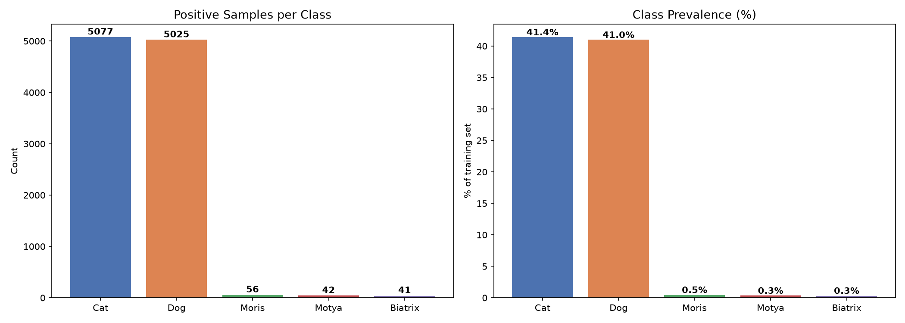
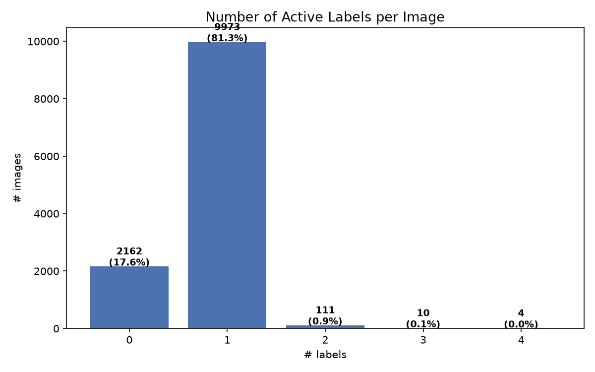
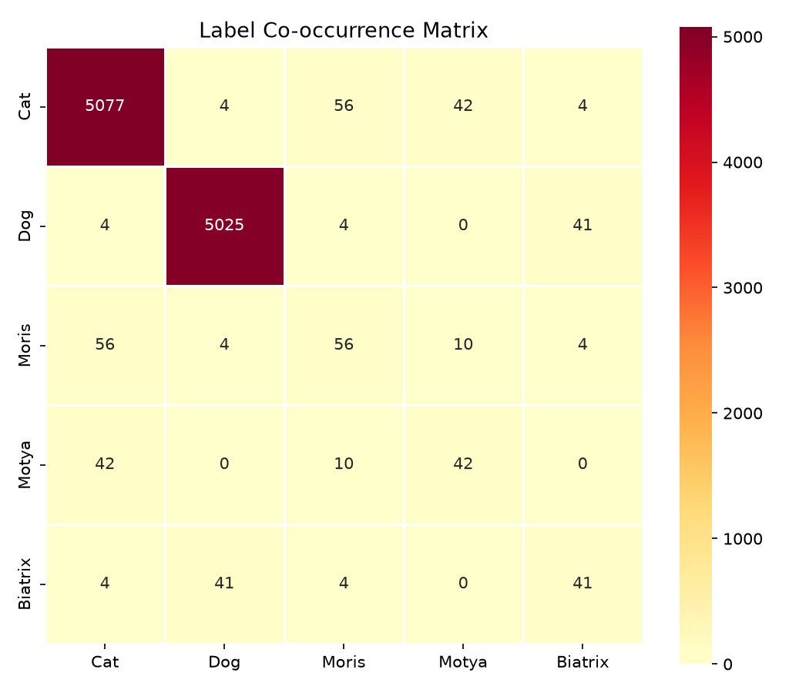
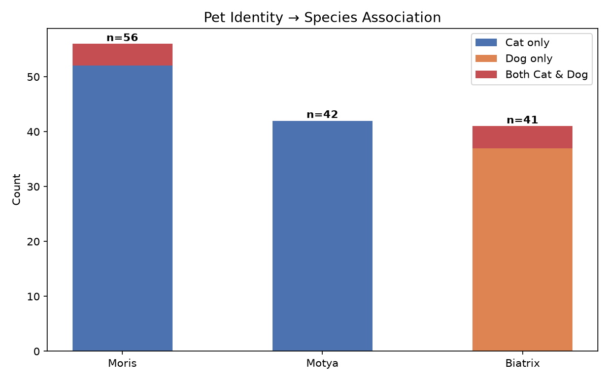
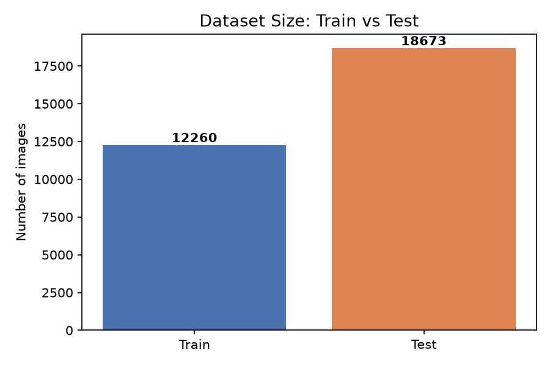
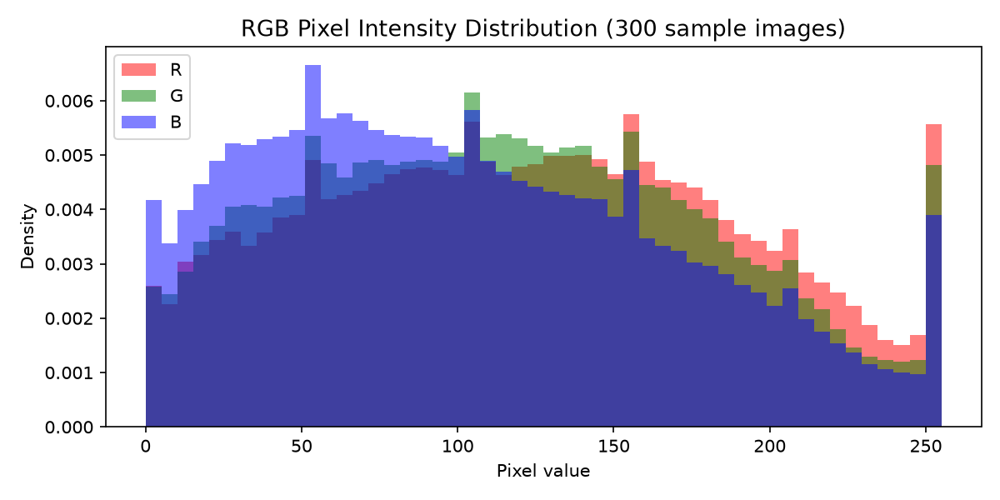
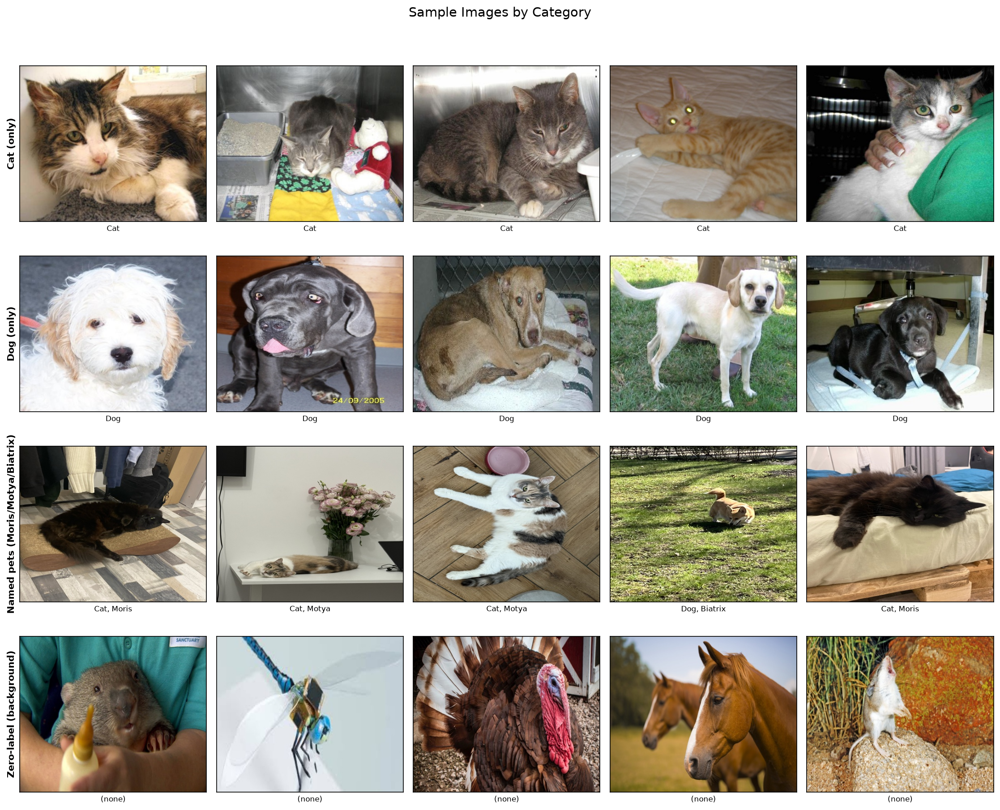

# Assignment #2 — Deep Learning: CNN Multi-Label Pet Classification

**Course**: AI301 Deep Learning  
**Competition**: Kaggle In-Class — Multi-label Pet Classification  
**Target Metric**: Macro F1-score  

---

## Table of Contents

1. [Exploratory Data Analysis (EDA)](#1-exploratory-data-analysis-eda)
   - [1.1 Dataset Overview](#11-dataset-overview)
   - [1.2 Class Distribution & Imbalance](#12-class-distribution--imbalance)
   - [1.3 Multi-label Structure](#13-multi-label-structure)
   - [1.4 Label Co-occurrence & Pet Identity Mapping](#14-label-co-occurrence--pet-identity-mapping)
   - [1.5 Image Properties](#15-image-properties)
   - [1.6 Visual Inspection](#16-visual-inspection)
   - [1.7 Data Integrity](#17-data-integrity)
2. [Metric Analysis](#2-metric-analysis)
   - [2.1 Target Metric: Macro F1](#21-target-metric-macro-f1)
   - [2.2 Complementary Metrics](#22-complementary-metrics)
   - [2.3 Alternative Target Metric Proposal](#23-alternative-target-metric-proposal)
3. [Validation Strategy](#3-validation-strategy)
   - [3.1 Approach: Multilabel Stratified K-Fold](#31-approach-multilabel-stratified-k-fold)
   - [3.2 Fold Distribution](#32-fold-distribution)
   - [3.3 CV–LB Correlation Considerations](#33-cvlb-correlation-considerations)
4. [CNN Model](#4-cnn-model) *(upcoming)*
5. [Ensembling](#5-ensembling) *(upcoming)*
6. [Conclusions](#6-conclusions) *(upcoming)*

---

## 1. Exploratory Data Analysis (EDA)

### 1.1 Dataset Overview

| Property | Train | Test |
|:---------|------:|-----:|
| Number of images | 12,260 | 18,673 |
| Image dimensions | 450 × 375 px | 450 × 375 px |
| Color mode | RGB | RGB |
| Labels per image | 5 binary columns | 5 binary columns (to predict) |

The test set is **~52% larger** than the training set, which is noteworthy — test distribution may contain different proportions of categories.

**Labels**: `Cat`, `Dog`, `Moris`, `Motya`, `Biatrix` — each image receives a binary label for each of the 5 classes.

### 1.2 Class Distribution & Imbalance



| Class | Positive Samples | Prevalence |
|:------|----------------:|-----------:|
| Cat | 5,077 | 41.4% |
| Dog | 5,025 | 41.0% |
| Moris | 56 | 0.46% |
| Motya | 42 | 0.34% |
| Biatrix | 41 | 0.33% |

**Key insight**: Extreme class imbalance. `Cat` and `Dog` collectively represent ~82% of all positive labels, while the three named pets (`Moris`, `Motya`, `Biatrix`) each have fewer than 60 positive samples — roughly **100× less frequent** than the major classes. This imbalance is the central challenge of this competition and directly impacts:
- Loss function choice (weighted BCE or Focal Loss required)
- Threshold tuning (0.5 default will fail for rare classes)
- Validation strategy (standard random split would leave folds with 0 positives for rare classes)

### 1.3 Multi-label Structure



| # Active Labels | Count | % of Dataset |
|:---:|------:|-----------:|
| 0 | 2,162 | 17.6% |
| 1 | 9,973 | 81.3% |
| 2 | 111 | 0.9% |
| 3 | 10 | 0.1% |
| 4 | 4 | 0.03% |

**Observations**:
- **81.3% of images** have exactly one label — predominantly species-only labels (`Cat` or `Dog`).
- **17.6% have zero labels** — these are "background" or "other" images containing neither a cat nor a dog. These are **not noise** — they are intentional negative examples the model must learn to predict as all-zeros.
- **~1% have 2+ labels** — these are images of named pets, which always co-occur with their species label (e.g., `Cat=1, Moris=1`).

### 1.4 Label Co-occurrence & Pet Identity Mapping




The co-occurrence analysis reveals a clear hierarchical structure:

| Pet Name | Species | Evidence |
|:---------|:--------|:---------|
| **Moris** | Cat | 56/56 images with Moris also have Cat=1 |
| **Motya** | Cat | 42/42 images with Motya also have Cat=1 |
| **Biatrix** | Dog | 41/41 images with Biatrix also have Dog=1 (4 also have Cat=1) |

**Notable anomaly**: There are **4 images** labeled with `Cat=1, Dog=1, Moris=1, Biatrix=1` simultaneously. These are likely multi-pet photographs containing both a cat (Moris) and a dog (Biatrix) in the same frame. These are not label noise — they are genuine multi-pet images.

**14 images** have multiple pet identity labels active simultaneously, consistent with photos showing multiple named pets together.

### 1.5 Image Properties




- **Uniform dimensions**: All images in both train and test sets are exactly **450 × 375 pixels** (RGB). No resizing inconsistencies or grayscale images.
- **RGB pixel distributions** show natural-image-like distributions across all three channels, with no evidence of synthetic data or unusual preprocessing artifacts.
- Because all images share identical dimensions, no special handling for variable aspect ratios is needed during data loading — a simple center crop or resize to the model's target input size suffices.

### 1.6 Visual Inspection




**Sample grid** shows representative images from each category:
- **Cat-only / Dog-only** images are standard pet photographs.
- **Named pets** (Moris, Motya, Biatrix) are specific individual animals with distinctive appearances.
- **Zero-label images** appear to contain scenes without cats or dogs — backgrounds, other animals, or ambiguous content.

**Mean image analysis** reveals that average images across categories show diffuse, centered subjects, confirming that pets are typically centered in the frame. The mean cat and dog images show slightly different color profiles, suggesting some learnable spatial/color signal at the class level.

### 1.7 Data Integrity

Integrity checks performed on all 12,260 train images and 18,673 test images:

| Check | Result |
|:------|:-------|
| Corrupt images | **0** (all loadable) |
| Missing files (vs. CSV) | **0** (all accounted for) |
| Non-RGB images | **0** (all RGB) |
| Variable dimensions | **None** (all 450×375) |
| Duplicate image IDs | **0** |

**Conclusion**: The dataset is clean. No data cleaning is required.

---

## 2. Metric Analysis

### 2.1 Target Metric: Macro F1

The competition uses **Macro F1-score**, defined as the unweighted mean of per-class F1 scores:

$$\text{Macro F1} = \frac{1}{5} \sum_{c=1}^{5} F_1^{(c)} \quad \text{where} \quad F_1^{(c)} = \frac{2 \cdot P^{(c)} \cdot R^{(c)}}{P^{(c)} + R^{(c)}}$$

**Strengths**:
- Treats all 5 classes equally regardless of frequency — directly incentivizes the model to perform well on rare classes (`Moris`, `Motya`, `Biatrix`).
- Balances precision and recall within each class.

**Weaknesses**:
- **Volatile on small classes**: With only ~8-9 validation samples per rare class (in a 5-fold split), misclassifying a single image can swing per-class F1 by ~12%, making local CV noisy and unreliable for rare classes.
- **Threshold-dependent**: F1 requires binary predictions, so the choice of probability threshold critically affects the score. A model with excellent probability calibration can still score poorly with a suboptimal threshold.
- **Non-differentiable**: Cannot be used directly as a training loss function — requires a surrogate loss (BCE, Focal Loss).

**Edge cases**:
- If the model predicts all-zeros for a rare class (zero recall), that class contributes F1 = 0, dragging the macro average down by 0.2.
- If the model predicts all-ones for a rare class, precision will collapse to ~0.3% (≈ class prevalence).

### 2.2 Complementary Metrics

We track the following alongside Macro F1 during training and validation:

| Metric | Purpose |
|:-------|:--------|
| **Per-class F1, Precision, Recall** | Diagnoses whether errors are from false positives (low precision) or false negatives (low recall) per class |
| **Micro F1** | Gives the global TP/FP/FN view across all classes, dominated by Cat & Dog — shows overall prediction quality |
| **PR-AUC (Average Precision) per class** | Threshold-independent evaluation of how well predicted probabilities rank positive above negative samples |
| **Mean Average Precision (mAP)** | Macro-average of per-class PR-AUC — directly comparable to Macro F1 but without threshold sensitivity |
| **ROC-AUC (macro)** | Measures discriminative ability across all operating points — useful for verifying the model has learned the task |
| **BCE Loss** | Continuous training loss — monitors probability calibration and convergence |

### 2.3 Alternative Target Metric Proposal

**Proposed alternative**: **Mean Average Precision (mAP)** — the macro-averaged PR-AUC across all 5 classes.

**Justification**:
- Like Macro F1, mAP gives equal weight to all classes regardless of frequency.
- Unlike Macro F1, mAP evaluates the **full ranking quality** of predicted probabilities rather than forcing binarization at a single threshold. This provides a more stable and informative signal, especially critical when validation sets for rare classes contain only 8–9 samples.
- mAP is less noisy during training because small changes in predicted probabilities produce smooth mAP changes, whereas F1 exhibits discontinuous jumps when a sample crosses the threshold boundary.
- Widely adopted in multi-label classification benchmarks (COCO, Pascal VOC).

---

## 3. Validation Strategy

### 3.1 Approach: Multilabel Stratified K-Fold

We use **5-fold Multilabel Stratified Cross-Validation** via the `iterative-stratification` library (`MultilabelStratifiedKFold`).

**Why this approach**:
- Standard random K-fold would fail for classes with only 41–56 positive samples — some folds could receive 0 positives for a rare class, making F1 undefined.
- Multilabel stratified splitting ensures each fold preserves the joint distribution of all 5 binary labels simultaneously, including the 2,162 zero-label samples.
- The same fold assignments (`validation/train_folds.csv`) are reused across all experiments for fair comparison.

**Why K=5**: Balances between having enough validation samples per fold (~2,452 images, including ~8-9 per rare class) and keeping sufficient training data (~9,808 images per fold).

### 3.2 Fold Distribution

| Fold | Total | Cat | Dog | Moris | Motya | Biatrix | Zero-label |
|:----:|------:|----:|----:|------:|------:|--------:|-----------:|
| 0 | 2,452 | 1,015 | 1,005 | 11 | 8 | 9 | 433 |
| 1 | 2,452 | 1,016 | 1,005 | 12 | 8 | 8 | 432 |
| 2 | 2,452 | 1,015 | 1,005 | 11 | 9 | 8 | 432 |
| 3 | 2,452 | 1,016 | 1,005 | 11 | 8 | 8 | 433 |
| 4 | 2,452 | 1,015 | 1,005 | 11 | 9 | 8 | 432 |

All folds are near-perfectly balanced. The maximum deviation for any class across folds is ±1 sample.

### 3.4 Adversarial Validation Results

As explicitly prescribed by the assignment instructions (*"make sure to do it with the same model as the main task"*), an adversarial validation experiment was conducted using an ImageNet-pretrained **EfficientNet-B0** backbone:
- Target label: `0` for training set images, `1` for test set images.
- Evaluated on a 25% holdout split using **ROC-AUC**.

**Results:**
- **Epoch 1 Val ROC-AUC**: `0.4978`
- **Epoch 2 Val ROC-AUC**: `0.5009`

**Conclusion & Theoretical Interpretation:**
A validation ROC-AUC of **0.5009** (almost exactly 0.50) indicates that the neural network performs no better than random guessing at distinguishing train images from test images. This proves that:
1. **No Covariate Shift**: The image feature distributions (lighting, backgrounds, camera types, cropping, pet poses) in `train/` and `test/` are virtually identical.
2. **High CV–LB Correlation Expected**: Local out-of-fold cross-validation scores will be an exceptionally trustworthy proxy for the Kaggle Public & Private leaderboards.
3. No domain adaptation, sample re-weighting, or special adversarial filtering of train samples is required.

---

## 4. CNN Model

*Work in progress — will include baseline model (EfficientNet-B3 via timm), custom CNN/block implementation, optimizer/scheduler experiments, GradCAM and gradient flow visualizations, and LB vs. CV comparison.*

---

## 5. Ensembling

*Work in progress — will include ensemble of top CNN models via prediction averaging, optional stacking with Logistic Regression, and LB vs. CV comparison.*

---

## 6. Conclusions

*To be completed after all experiments.*

---

## Project Structure

```
Assignment_02_Deep_Learning/
├── data/
│   ├── train/              # 12,260 training images (450×375 RGB JPG)
│   ├── test/               # 18,673 test images (450×375 RGB JPG)
│   ├── train.csv           # Training labels (image_id + 5 binary columns)
│   ├── test.csv            # Test image IDs
│   └── sample_submission.csv
├── eda/
│   ├── generate_eda_plots.py
│   ├── 01_class_distribution.png
│   ├── 02_labels_per_image.png
│   ├── 03_label_cooccurrence.png
│   ├── 04_identity_species.png
│   ├── 05_sample_images.png
│   ├── 06_train_vs_test_size.png
│   ├── 07_mean_images.png
│   └── 08_pixel_distributions.png
├── validation/
│   ├── check_data_integrity.py
│   ├── create_folds.py
│   ├── metrics.py
│   └── train_folds.csv     # 5-fold multilabel stratified split
└── report.md               # This file
```

